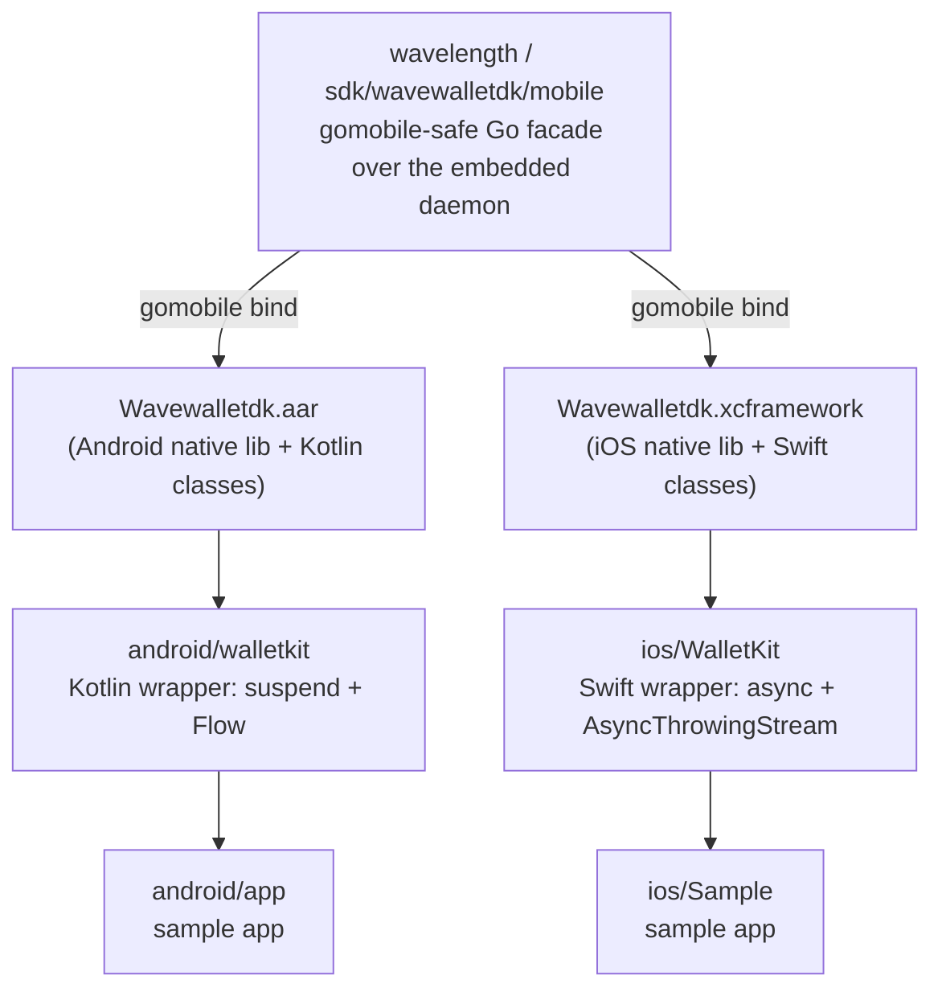

# wavelength-mobile

`wavelength-mobile` runs the
[wavelength](https://github.com/lightninglabs/wavelength) wallet — a
self-custodial Bitcoin wallet system written in Go that unifies an Ark client, a
Lightning swap engine, and an on-chain wallet behind one daemon (`waved`) —
directly inside a mobile app. The whole daemon is embedded in the app's own
process through [`gomobile`](https://pkg.go.dev/golang.org/x/mobile/cmd/gomobile),
so a user can board into Ark, hold and transfer VTXOs, swap into and out of the
Lightning Network, send and receive on-chain, and unilaterally exit to the chain
at any time — all from their phone, while keeping sole custody of their coins.

There is no separate daemon process and no open network port: the app calls the
embedded wallet across a private in-memory gRPC channel, so nothing ever listens
on a socket. This repo holds the idiomatic Kotlin and Swift wrappers over the
gomobile bindings, plus sample apps that drive them end to end.

## How the pieces fit



The Go facade and the binding build live in **wavelength**
(`sdk/wavewalletdk/mobile`, `make mobile-android` / `mobile-ios`). This repo
consumes the bindings and shows an app driving them end to end: boot the
embedded wallet, create a key, sync the chain from Esplora, and read balances.

## Repository layout

| Path | Contents |
|------|----------|
| `android/walletkit/` | Idiomatic Kotlin wrapper (`suspend` + `Flow` + typed models) over the generated bindings. The Android library other apps depend on. |
| `android/app/` | Native Signet wallet in Kotlin/Jetpack Compose, with encrypted credentials, device unlock, payments, credit and activity. |
| `ios/WalletKit/` | Idiomatic Swift wrapper (`actor` + `async` + `AsyncThrowingStream` + `Codable`). Mirrors the Kotlin library. |
| `ios/Sample/` | Native SwiftUI wallet with dark/light themes, Face ID, balance and activity, send/receive, refresh, exit, and recovery. |
| `scripts/fetch-aar.sh` | Builds the pinned source plus mobile bridge and stages `Wavewalletdk.aar` with provenance under `android/walletkit/libs`; release-tag overrides download a packaged AAR. |
| `scripts/fetch-xcframework.sh` | Builds the pinned Wavelength source with the carried iOS recovery bridge and stages `Wavewalletdk.xcframework`; verifies source/patch provenance. |
| `Makefile` | One-command iOS Simulator build, test, run, and opt-in live regtest workflows. |
| `docs/` | Architecture, the Android workflow, and signet setup. |

The Android and iOS hosts share the embedded Go wallet engine. Android's first
wallet milestone covers Signet payments and activity. The remaining screen
parity, including diagnostics and background delivery, is tracked in
[`docs/android-port.md`](docs/android-port.md).

Both SDK pins now identify reviewed source commits: `.wavelength-version` for
Android and `.wavelength-ios-version` for iOS. Both builds apply the existing
platform-neutral mobile bridge in `scripts/wavelength-ios-recovery.patch`.
The separate pins let each platform adopt changes after its own validation.
Fetch scripts record the exact source commit and bridge digest beside the
ignored native artifact; `--if-needed` reuses only matching provenance.

## Quick start (Android)

You need:

1. The [`gh` CLI](https://cli.github.com/) authenticated for read access to
   Wavelength, plus Go and gomobile. The current commit pin builds from source;
   `WAVELENGTH_DIR` can select a checkout prepared at that exact pin and bridge.
2. The Android SDK and NDK. The [`android` CLI](https://developer.android.com/tools/agents/android-cli)
   installs them: `android sdk install platform-tools emulator
   platforms/android-36 build-tools/36.1.0 ndk/29.0.14206865
   system-images/android-36/google_apis/arm64-v8a`.
3. JDK 17 or newer.

```bash
# 1. Build or reuse the exact pinned native binding.
./scripts/fetch-aar.sh --if-needed

# 2. Build the wallet app.
cd android && ./gradlew :app:assembleDebug

# 3. Run it on an emulator (or a device).
android emulator start medium_phone
android run --apks=app/build/outputs/apk/debug/app-debug.apk
```

The `.aar` carries the daemon compiled for every Android ABI, so it is large
(150 MB and up). `fetch-aar.sh` stages it and `.gitignore` keeps it out of
the repo.

## The API

Use the **wrapper**, not the raw bindings. The Kotlin `WalletClient`
(`engineering.lightning.wavewalletdk.client`) gives every call a `suspend` function
that runs off the main thread and returns a typed model, and exposes wallet
activity as a `Flow`:

```kotlin
val client = WalletClient()
client.start(WalletConfig.signet(dataDir = dir))     // suspend; blocks off-thread
client.createWallet("my-password".toByteArray())
val info = client.getInfo()                           // typed Info
client.activity(includeExisting = true).collect { e -> /* Entry */ }
```

Swift's `WalletClient` mirrors this with `async`/`throws` and an
`AsyncThrowingStream` (see `ios/`).

Underneath, the generated `Mobile` class is the callback-free escape hatch:
`start(configJson)` (synchronous, blocks until serving), JSON-bytes verbs that
throw, `subscribe(req)` returning a pull-`Subscription`, and scalar shortcuts
(`confirmedBalanceSat()`, `walletReady()`). `docs/architecture.md` explains the
design; the full method list is in wavelength's
[`docs/wavewalletdk_mobile.md`](https://github.com/lightninglabs/wavelength/blob/main/docs/wavewalletdk_mobile.md).

## Documentation

- [`docs/api-guide.md`](docs/api-guide.md) — common operations as a cookbook,
  with Kotlin and Swift side by side (boot, create/unlock, sync, balance,
  activity stream, errors).
- [`docs/architecture.md`](docs/architecture.md) — how the embedded wallet,
  the in-memory transport, and the JSON boundary work.
- [`docs/android.md`](docs/android.md) — the Android build and run workflow in
  detail, including the `android` CLI and emulator.
- [`docs/signet.md`](docs/signet.md) — pointing the wallet at a signet
  environment and watching it sync.
- [`ios/README.md`](ios/README.md) — the Swift `WalletKit` wrapper, native
  wallet, one-command Simulator workflow, and environment-driven regtest
  validation.
