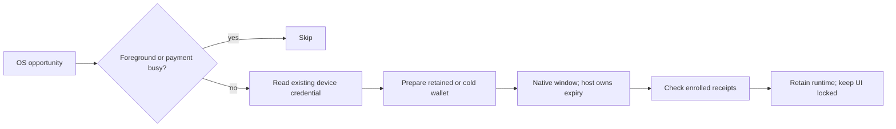
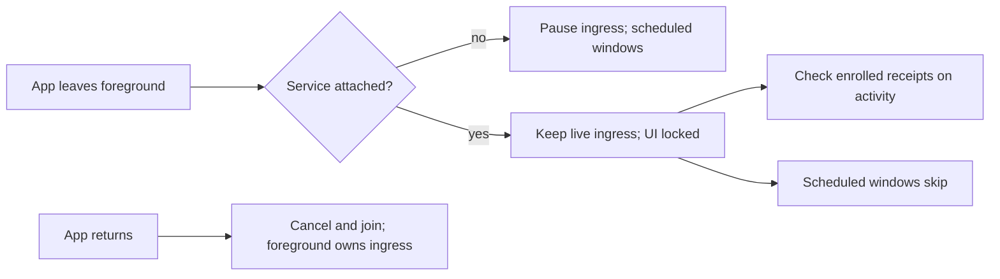

# Android notifications and background maintenance

## Available in this app change

WorkManager schedules one unique connected-network maintenance job every fifteen
minutes. This is an earliest opportunity, not a timer or round-deadline promise.
WorkManager restores its jobs across ordinary process death and reboot. Android
can defer them in Doze, restrict the app or suppress work after force-stop until
the user opens the app again. No exact-alarm permission or battery-optimization
exemption is requested, and no service runs unless the user turns on
[Keep running in background](#keep-running-in-background).

The native runtime and wallet directories are shared with the foreground app.
There is no second process or second daemon. A single lifecycle owner covers
startup, wallet switching and the background window:



Preparation checks the Android user is unlocked after boot. It never prompts,
creates a wallet or generates a wallet password. The application retains its
normal UI authentication gate even when native keys are available unattended.
A failed cold preparation stops only the runtime created by that preparation.
A prepared retained runtime survives window expiry.

A twenty-eight-second fallback includes preparation and receipt checks. Expiry
or foreground return signals the exact native window ID. Cancelling a worker
retains and joins the host task; it never releases ownership merely because the
OS callback was cancelled. Cancellation callbacks also join before another
owner can start. An uncooperative native call can extend cleanup beyond the
nominal deadline. The native window and targeted reads have their own deadlines.
Existing state-creating payment calls return before mailbox intake is paused.

## Keep running in background

Settings → Notifications → **Keep running in background** is an opt-in switch,
off by default. While it is on, `WalletKeepAliveService` runs as a foreground
service with an ongoing "Wavelength is running" notification. The notification
shows no balance, amount or network, opens the app when tapped and has a
**Stop** action.

The service owns no wallet state. It keeps the process alive and tells the
session it is attached; the session decides what runs:



- Leaving the app locks the UI as before, but the daemon keeps its live mailbox
  intake instead of being paused. Nothing in the background can create a
  wallet, prompt for credentials or dispatch a payment; send and receive still
  require the visible, authenticated app.
- Enrolled receipts are checked when the activity stream reports a completed
  receive, using the same local proof and consent rules as a scheduled window.
- A scheduled or push-triggered window that finds the service connected records
  that and returns. It would otherwise finish by pausing the ingress the service
  keeps live.
- Returning to the app cancels the background owner and joins it before the
  foreground starts its own observations. **Stop**, or turning the switch off,
  pauses ingress again and falls back to scheduled windows.

Android only admits a foreground service start while the app is visible, so the
service is started when the switch is turned on and re-armed each time the app
is opened. It is not started at boot. If Android restarts the process and
refuses the service, the wallet stays on scheduled windows until the app is
next opened. A restarted service prepares the wallet the same way a scheduled
window does: it reads the existing device credential first and stops itself if
there is no wallet.

The service declares the `specialUse` foreground service type, which has no
time limit; Google Play asks for a justification of that type at review, and
the manifest's `PROPERTY_SPECIAL_USE_FGS_SUBTYPE` states it. No wake lock or
battery-optimization exemption is requested, so Doze can still suspend network
access while the device is idle. Each background stay is recorded as one
"Background service" run in Diagnostics → Background.

## Local payment alerts

Settings → Notifications offers per-network payment alerts, initially off.
Android notification permission is requested only after consent. Generic text
is the default. Showing received amounts requires separate explicit consent,
including lock-screen presentation. Changing consent starts a fresh epoch and
excludes existing invoice requests.

Only a successful local invoice creation can enroll its typed native receipt
reference. Admission captures the current wallet identity, network, connection and
consent epoch before the create call. The successful response adds the typed
source reference, canonical identity and original principal.
A timeout-recovered invoice or historical activity does not enroll retrospectively.
A bounded background check reads those specific source references while the
native work window advances them. A busy window can consume its full budget.
Reading concurrently lets a verified receipt appear before the host deadline. Only a complete
matching source/canonical proof can present a receipt. Push payloads cannot supply
its amount, receipt reference, invoice, signer or endpoint. Amounts remain hidden
unless the current matching consent explicitly permits them.

Receipt metadata and presentation claims live in an app-private atomic file under
`noBackupFilesDir`, excluded from Android backup. No recovery words, wallet
passwords, invoices, delivery credentials or preimages are stored there. Claims
persist before notification insertion; a crash can omit an alert but cannot replay
it as another banner. A foreground-visible completed receipt is marked seen.
The ledger is bounded and rotates finite native reads so unpaid requests cannot
permanently starve newer ones. Unreadable evidence fails closed without overwrite.

A tap resolves a locally claimed receipt, waits for UI authentication and opens
its native Activity entry. Another network asks the user to open that network;
the tap does not switch a wallet or approve a payment.

## Firebase push notifications

The publisher supplies the following values in the ignored
`android/firebase.local.properties` before building the tester APK.

```properties
APP_ID=<Firebase Android application ID>
PROJECT_ID=<Firebase project ID>
SENDER_ID=<project number>
API_KEY=<Firebase Android client API key>
RELAY_URL=<HTTPS relay origin>
RELAY_ALIAS=<publisher-configured Android application alias>
RELAY_NETWORK=signet
RELAY_SWAP_ISSUER=<trusted compressed swap source public key in hex>
```

Register package `engineering.lightning.wavelength.wallet` in Firebase. Use
the same publisher-controlled signing key for distributed APKs. Configure its
certificate digest at the relay. The tester needs a supported Google Play
services device and can install the signed APK directly. Play Integrity checks
the package, publisher signature, device integrity and fresh registration
challenge. Each opted-in installation holds its own Android Keystore key.
The Firebase project owner is the publisher. Testers need no project access.
Keep relay sender credentials on the server.

With the default network endpoints selected, enable **Payment alerts**, then
**Push notifications** in Settings → Notifications. The second switch registers
the Firebase installation for delivery. The wallet signs each source offer,
and the installation signs its corresponding relay binding. The local route
becomes usable once both producers are bound. Local receipt verification and
amount consent apply to every payment alert. WorkManager retries registration
and rotates changed destinations. Opening the wallet permits wallet signatures
for renewal or removal. Opting out immediately disables the local route and
queues relay revocation. Expired routes reject incoming hints.

For an emulator without a physical-device integrity verdict, use a debug APK
with a separate relay alias ending in `.emulator`. Verify the installed APK's
signer, then pair its **Emulator pairing fingerprint** at the relay. This
credential is specific to the test installation. Distribute tester APKs with
the standard signer-based alias. Switching Firebase projects requires a new
configured APK and relay policy, followed by fresh device registration.

For diagnostic context, wake data can optionally carry `wake_reason` and the
UTC second `wake_deadline_unix` as strings. Only a locally validated wake route
can display these fields. An older wake shows **Reason unavailable**. The
periodic worker reports **Scheduled refresh** and shows the condition that
caused a worker to skip. If WorkManager keeps a pending request, that run shows
the context of the kept request. Unresolved routes and routes for a different
network stay out of the wallet's Background history.

The app/relay contract and typed receipt checks are intentionally stricter than
trusting a remote amount or rendering an arbitrary remote notification. No new
upstream native SDK version is required for this app layer.

## Diagnostics and validation

Diagnostics → Background records bounded actual host stages and outcomes in an
atomic app-private journal across process restarts. The debug build can schedule
a one-time check after five seconds. Leave the app in the background to exercise
it. This is an app UI action, not an exported receiver or production RPC bypass.

Run JVM tests and lint without instrumenting the funded emulator. The Android
Gradle instrumented runner can uninstall the wallet after tests. Upgrade only
with `adb install -r`; never clear wallet data for lifecycle tests.

Use ordinary Home/background entry for a warm check. For a cold check, schedule
the debug opportunity, go Home, then kill the background app process without
force-stopping it. Inspect the persisted journal after the worker returns. Test
foreground takeover while a window is running and repeat the same receipt to
verify no duplicate banner. These tests prove a native attempt and local receipt
presentation, not automatic completion of a round before its deadline.

Richer wake context, startup timings, native result fields and related logs are
described in [background traces](background-traces.md).

The 28-second per-attempt fallback is an application work-slice policy, not an
Android execution limit. WorkManager cancellation and foreground takeover still
cancel immediately and join native ownership. We deliberately avoid holding an
idle mailbox polling loop for WorkManager's much longer runtime allowance.
The native safety ceiling is 30 seconds, so it does not truncate a host-owned
attempt after 15 seconds. Scheduled work and authenticated hints can retry the
existing persisted work on a later opportunity.
