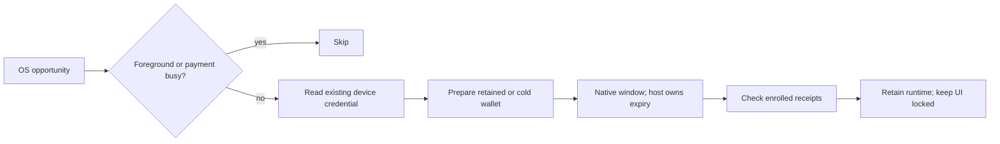

# Android notifications and background maintenance

## Available in this app change

WorkManager schedules one unique connected-network maintenance job every fifteen
minutes. This is an earliest opportunity, not a timer or round-deadline promise.
WorkManager restores its jobs across ordinary process death and reboot. Android
can defer them in Doze, restrict the app or suppress work after force-stop until
the user opens the app again. No exact-alarm permission, perpetual service or
battery-optimization exemption is requested.

The native runtime and wallet directories are shared with the foreground app.
There is no second process or second daemon. A single lifecycle owner covers
startup, wallet switching and the background window:



Preparation checks the Android user is unlocked after boot. It never prompts,
creates a wallet or generates a wallet password. The application retains its
normal UI authentication gate even when native keys are available unattended.
A failed cold preparation stops only the runtime created by that preparation.
A prepared retained runtime survives window expiry.

A twenty-eight-second fallback includes preparation and receipt checks. Expiry
or foreground return signals the exact native window ID. Cancelling a worker
retains and joins the host task; it never releases ownership merely because the
OS callback was cancelled. Cancellation callbacks also join before another
owner can start. An uncooperative native call can extend cleanup beyond the
nominal deadline. The native window and targeted reads have their own deadlines.
Existing state-creating payment calls return before mailbox intake is paused.

## Local payment alerts

Settings → Notifications offers per-network payment alerts, initially off.
Android notification permission is requested only after consent. Generic text
is the default. Showing received amounts requires separate explicit consent,
including lock-screen presentation. Changing consent starts a fresh epoch and
excludes existing invoice requests.

Only a successful local invoice creation can enroll its typed native receipt
reference. Admission captures the current wallet identity, network, connection and
consent epoch before the create call. The successful response adds the typed
source reference, canonical identity and original principal.
A timeout-recovered invoice or historical activity does not enroll retrospectively.
A bounded background check reads those specific source references. Only a complete
matching source/canonical proof can present a receipt. Push payloads cannot supply
its amount, receipt reference, invoice, signer or endpoint. Amounts remain hidden
unless the current matching consent explicitly permits them.

Receipt metadata and presentation claims live in an app-private atomic file under
`noBackupFilesDir`, excluded from Android backup. No recovery words, wallet
passwords, invoices, delivery credentials or preimages are stored there. Claims
persist before notification insertion; a crash can omit an alert but cannot replay
it as another banner. A foreground-visible completed receipt is marked seen.
The ledger is bounded and rotates finite native reads so unpaid requests cannot
permanently starve newer ones. Unreadable evidence fails closed without overwrite.

A tap resolves a locally claimed receipt, waits for UI authentication and opens
its native Activity entry. Another network asks the user to open that network;
the tap does not switch a wallet or approve a payment.

## Prepared FCM integration; not active yet

There is no Wavelength Firebase project configured for this build. The reference
relay currently ships Apple App Attest/APNs modules, not Android device admission
or FCM delivery. This PR creates no Firebase project, credentials, cloud resources
or server bypass. Scheduled maintenance and local alerts work without FCM.

The app includes an FCM data-message receiver, strict versioned hint parsing,
local route lookup and worker handoff. A hint must name a known unexpired local
route. The worker rechecks selected network, wallet identity, connection and
consent; cold startup checks the actual native identity again. Payload fields
never choose a wallet, URL, invoice or RPC. The route store has no app/debug
registrar in this PR and therefore stays empty. Adding Firebase config alone
cannot activate enrollment. Token/installation registration and uploads are not
performed, and FCM automatic initialization is disabled.

Publisher-local Firebase values can be staged in the ignored file
`android/firebase.local.properties`:

```properties
APP_ID=<Firebase Android application ID>
PROJECT_ID=<Firebase project ID>
SENDER_ID=<project number>
API_KEY=<Firebase Android API key>
```

These public client configuration values are not server credentials. Never put
a service-account key in the APK or repository. The Android app registration must
use package `engineering.lightning.wavelength.wallet` and the intended signing
certificate. The build works with all four values absent.

Activation requires a separate reviewed server/application integration:

1. Select and implement publisher-controlled Android device authentication that
   binds the exact relay challenge, application/signing audience, installation key
   and request payload. Do not relax the Apple authenticator or add an HTTP bypass.
2. Add an FCM delivery provider with server-held credentials, destination refresh,
   expiry and invalid-registration handling. Use the current Firebase registration
   API appropriate to the configured SDK; installation identifiers are sensitive
   routing metadata, not authentication.
3. Add client enrollment, renewal/revocation, rotation and lost-response recovery.
   Persist relay grants before wallet-authorized source binding. Only authenticated
   enrollment may populate `notification-relay-routes.json` after verified binding.
4. Send **data-only** messages with `version`, `route_id`, `kind` (`wake` or
   `payment_activity`) and a lowercase 32-byte hex `event_id` for payment hints.
   Never send an FCM `notification` payload: Android may display it before app
   validation. Use normal priority for silent maintenance hints. High priority is
   reserved for user-visible events and must follow Firebase policy.
5. Validate real provider delivery, route revocation and physical-device behavior.
   An emulator worker or local fixture is not evidence of push delivery.

The app/relay contract and typed receipt checks are intentionally stricter than
trusting a remote amount or rendering an arbitrary remote notification. No new
upstream native SDK version is required for this app layer.

## Diagnostics and validation

Diagnostics → Background records bounded actual host stages and outcomes in an
atomic app-private journal across process restarts. The debug build can schedule
a one-time check after five seconds. Leave the app in the background to exercise
it. This is an app UI action, not an exported receiver or production RPC bypass.

Run JVM tests and lint without instrumenting the funded emulator. The Android
Gradle instrumented runner can uninstall the wallet after tests. Upgrade only
with `adb install -r`; never clear wallet data for lifecycle tests.

Use ordinary Home/background entry for a warm check. For a cold check, schedule
the debug opportunity, go Home, then kill the background app process without
force-stopping it. Inspect the persisted journal after the worker returns. Test
foreground takeover while a window is running and repeat the same receipt to
verify no duplicate banner. These tests prove a native attempt and local receipt
presentation, not automatic completion of a round before its deadline.

Richer wake context, startup timings, native result fields and related logs are
described in [background traces](background-traces.md).

The 28-second per-attempt fallback is an application work-slice policy, not an
Android execution limit. WorkManager cancellation and foreground takeover still
cancel immediately and join native ownership. We deliberately avoid holding an
idle mailbox polling loop for WorkManager's much longer runtime allowance.
The native safety ceiling is 30 seconds, so it does not truncate a host-owned
attempt after 15 seconds. Scheduled work and authenticated hints can retry the
existing persisted work on a later opportunity.
